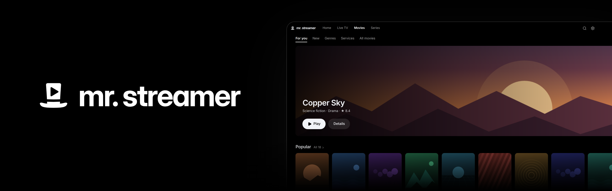
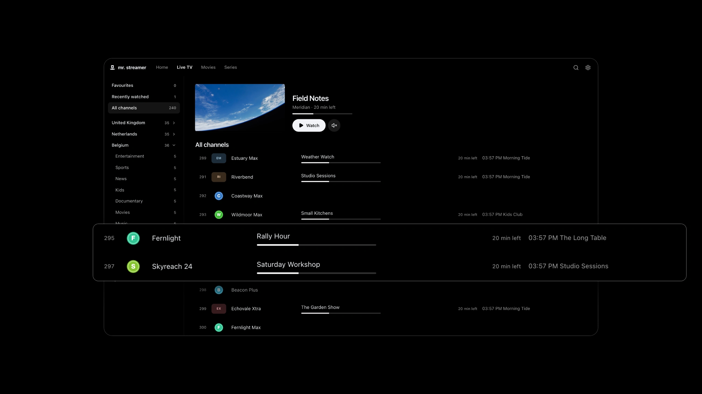
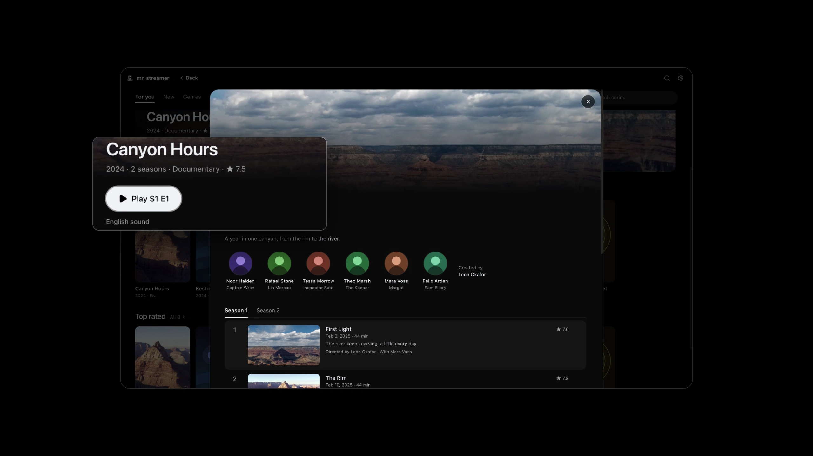
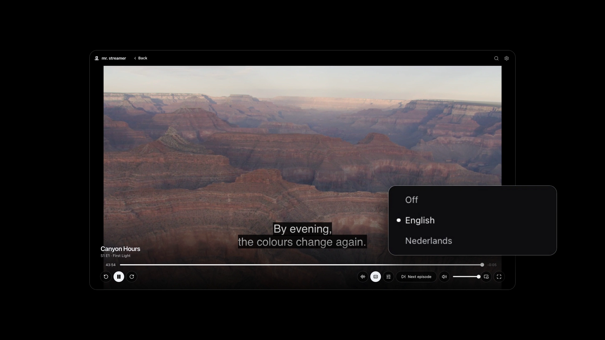

<h1 align="center">Mr. Streamer</h1>

<strong>IPTV without the junk.</strong>

A clean, fast, open-source IPTV player for macOS, Windows and Linux. Bring your own Xtream Codes or M3U subscription and watch live TV with a programme guide, movies and series. It includes no channels, shows no ads and needs no account.

  <a href="https://apps.microsoft.com/detail/9N45GG76ZP4T?referrer=appbadge">
    <picture>
      <source media="(prefers-color-scheme: dark)" srcset="https://get.microsoft.com/images/en-us%20light.svg">
      
    </picture>
  </a>

<strong><a href="https://github.com/Mr-Streamer-OSS/MrStreamer/releases/latest">Download for macOS, Windows or Linux</a></strong>

### Live TV

A programme guide with [search](docs/user/live-tv.md#the-guide), favourites in [the order you want](docs/user/live-tv.md#the-guide), and the channels you watched last. XMLTV guides of [your own](docs/user/subscriptions.md#guides-from-other-addresses) fill in the channels it doesn't cover.

### Movies and series

Stories, artwork and cast, with resume, the next episode and a [watchlist](docs/user/movies-and-series.md#watchlist). You can [mark episodes watched or unwatched](docs/user/movies-and-series.md#marking-episodes).

### Sound and subtitles

Every track your provider sends, on live channels and on demand.

The pictures come from a test provider with made-up titles and public-domain footage.

## What you need

An IPTV subscription with Xtream Codes access: a server address, username and password, or an M3U link that contains them. An M3U playlist link starts with live TV. Version 0.0.9 can also import movies and episodes after you [map its groups](docs/user/subscriptions.md#mapping-mixed-playlists). You can add [several](docs/user/subscriptions.md), and their channels, movies and series show together.

Mr. Streamer supplies no channels, playlists or subscriptions. It has no ads, your login and what you watched stay on your computer, and it's free and open source.

<strong>Install notes</strong>

On Windows, the [Microsoft Store](https://apps.microsoft.com/detail/9N45GG76ZP4T?referrer=appbadge) installs Mr. Streamer and keeps it updated. Every other installer is on the [Releases page](https://github.com/Mr-Streamer-OSS/MrStreamer/releases/latest).

| System                              | File                                          |
| ----------------------------------- | --------------------------------------------- |
| macOS 13 or later, Apple silicon    | `Mr-Streamer-<version>-mac-arm64.dmg`         |
| Windows 11, 64-bit                  | `Mr-Streamer-<version>-win-x64-setup.exe`     |
| Linux, 64-bit (Ubuntu, Debian)      | `Mr-Streamer-<version>-linux-amd64.deb`       |
| Linux, 64-bit (other distributions) | `Mr-Streamer-<version>-linux-x86_64.AppImage` |

**macOS:** open the DMG and drag Mr. Streamer to Applications.

**Windows:** without the Store, run the setup file. It installs for your user account, without administrator rights. The installer isn't signed yet, so SmartScreen may warn that the app is unrecognised: choose **More info**, then **Run anyway**.

**Linux:** install the deb with `sudo apt install ./Mr-Streamer-<version>-linux-amd64.deb`. The AppImage runs without installing: make it executable (`chmod +x`) and open it. AppImages need FUSE 2; on Ubuntu, `sudo apt install libfuse2t64` provides it.

<strong>First steps</strong>

1. Enter your provider's server address, username and password, or paste the M3U link your provider sent. Mr. Streamer checks the login and loads your channels; movies and series follow. A playlist link starts with channels. In 0.0.9, map its groups in Settings to import movies and series too. An address without `http://` or `https://` connects encrypted when the server allows it; otherwise Mr. Streamer asks before sending your login unencrypted.
2. **Live TV** lists every channel with what's on now and next. Click one to watch; the list opens over the picture to switch.
3. **Movies** and **Series** open on For you. A poster opens its details; **Play** or **Resume** starts it.
4. In Settings (⌘, or Ctrl ,), **General** sets the app's own language (English, Nederlands, Français, Deutsch or Español), the languages for titles, sound and subtitles, and your update channel; **Subscriptions** shows your accounts, refreshes their lists and adds another one, whose channels, movies and series show beside the first's.

Mr. Streamer looks for updates after it starts and every four hours. When one is ready, **Update** appears in the top bar: download it, then restart when it suits you. **Stable** gets tested releases, **Nightly** the newest builds.

<strong>Limits</strong>

- One stream at a time, across every subscription you add: Xtream Codes access, or an M3U playlist. Mixed-playlist movie and series import needs 0.0.9 and explicit group mapping.
- [Download movies and episodes](docs/user/downloads.md) to watch offline. Live TV cannot be recorded. [Playing on a TV](docs/user/playback.md#playing-on-a-tv) uses AirPlay on macOS and Google Cast on Windows; the Linux builds play on the computer only.
- Surround sound that needs converting plays as stereo, and converting a picture uses much more of your computer's processor than playing it as it is.
- Choosing another sound track on a live channel starts the channel again for a moment.
- The Windows installer isn't signed yet; the Microsoft Store version is.

[What plays](docs/user/playback.md#known-limits) lists the formats and every known limit.

## Help

[Live TV](docs/user/live-tv.md) · [Movies and series](docs/user/movies-and-series.md) · [Downloads](docs/user/downloads.md) · [Updates and channels](docs/user/updates.md) · [What plays](docs/user/playback.md) · [Troubleshooting](docs/user/troubleshooting.md) · [Privacy](docs/privacy.md)

Found a bug? [Report it](https://github.com/Mr-Streamer-OSS/MrStreamer/issues/new/choose) with your system, the Mr. Streamer version from Settings > About, and what happened.

## What's next

We're working hard on an iOS app, and it's in active development. iPadOS is planned next, with Apple TV to follow.

## Contributing

Mr. Streamer is open source and under active development. For now it accepts small bug fixes: [CONTRIBUTING.md](CONTRIBUTING.md) explains how to report a bug, run the app and send a fix.

## License

GPL-3.0. See [LICENSE](LICENSE). Installers include FFmpeg and x264, also under the GPL; their exact sources are attached to every release. Settings > About > Open-source licences lists every component the app ships, with its licence.

Movie and series details come from [TMDB](https://www.themoviedb.org). This application uses TMDB and the TMDB APIs but is not endorsed, certified, or otherwise approved by TMDB. Where titles stream comes from [JustWatch](https://www.justwatch.com).

Store screenshots and the trailer include Big Buck Bunny (c) copyright 2008, Blender Foundation, [www.bigbuckbunny.org](https://www.bigbuckbunny.org), [CC BY 3.0](https://creativecommons.org/licenses/by/3.0/): excerpts, renamed and subtitled in the demo. Earth views: NASA. Grand Canyon footage: U.S. National Park Service.

## How it compares

VLC is a general media player. Kodi is compared with its official [IPTV Simple](https://github.com/kodi-pvr/pvr.iptvsimple) add-on.

### Getting set up

|                   | Platforms                                                                             | Xtream / M3U                                     | Guide (XMLTV)                                                                         | Movies and series                                            |
| ----------------- | ------------------------------------------------------------------------------------- | ------------------------------------------------ | ------------------------------------------------------------------------------------- | ------------------------------------------------------------ |
| **Mr. Streamer**  | macOS (Apple silicon), Windows, Linux                                                 | Xtream login, M3U link                           | Provider or playlist guide, then your own XMLTV guides; grid and catch-up from 0.0.13 | Library with TMDB details; M3U after mapping groups          |
| **TiviMate**      | Android TV                                                                            | Xtream Codes, M3U, Stalker Portal                | TV guide (EPG) grid; XMLTV source not stated                                          | Movies and shows                                             |
| **IPTV Smarters** | Android, Android TV, iPhone, iPad, Apple TV, macOS, Windows, LG and Samsung TVs       | M3U, provider API login (Xtream not named)       | EPG from your source; XMLTV address not stated                                        | Movies and series                                            |
| **IPTVX**         | iPhone, iPad, Apple TV, Apple Vision, Apple silicon Mac, Android, Android TV, Fire OS | Xtream, M3U, also Plex and SMB                   | Server EPG, or your own EPG URL                                                       | Movies and TV shows                                          |
| **VLC**           | Windows, macOS, Linux, Android, iOS, Apple TV                                         | Opens M3U playlists; Xtream login not documented | Not stated                                                                            | Plays playlist entries                                       |
| **Kodi**          | Windows, macOS, Linux, Android, iOS, tvOS, webOS, Raspberry Pi                        | M3U file or URL; Xtream login not documented     | XMLTV file or URL                                                                     | VOD from M3U media entries, listed as recordings or channels |

### Watching later and elsewhere

|                   | Downloads                                  | Live TV recording                              | Casting                                             | Price, source                                                           |
| ----------------- | ------------------------------------------ | ---------------------------------------------- | --------------------------------------------------- | ----------------------------------------------------------------------- |
| **Mr. Streamer**  | Movies, episodes; whole series from 0.0.12 | No                                             | AirPlay on macOS, Google Cast on Windows; not Linux | Free, open source (GPL-3.0)                                             |
| **TiviMate**      | Not stated                                 | Yes                                            | Not stated                                          | Free, premium upgrade                                                   |
| **IPTV Smarters** | Not stated                                 | Not stated                                     | Not stated                                          | Apple app: free, ads and a premium purchase; other platforms not stated |
| **IPTVX**         | On iPhone and iPad                         | With IPTVX Media Server on a NAS, Linux or Mac | AirPlay 2, casting to supported targets             | Free download, subscriptions                                            |
| **VLC**           | Convert/Save to a file                     | Record button saves what plays                 | Chromecast                                          | Free, open source                                                       |
| **Kodi**          | Not stated                                 | Not with IPTV Simple                           | Not stated                                          | Free, open source (GPL-2.0)                                             |

Checked 12 October 2026 against each project's own site, docs or store listing. Not stated means those sources don't say. TiviMate: [tivimate.com](https://tivimate.com), [Google Play](https://play.google.com/store/apps/details?id=ar.tvplayer.tv). IPTV Smarters: [getiptvsmarters.com](https://getiptvsmarters.com/download), [features](https://getiptvsmarters.com/features), [App Store](https://apps.apple.com/us/app/smarters-player-lite/id1628995509). IPTVX: [features](https://iptvx.app/features/index.html), [App Store](https://apps.apple.com/us/app/iptvx/id1451470024), [Google Play](https://play.google.com/store/apps/details?id=com.bendingx.iptvx.android). VLC: [videolan.org](https://www.videolan.org/vlc/), [M3U](https://wiki.videolan.org/M3U), [recording](https://docs.videolan.me/vlc-user/desktop/3.0/en/basic/recording/playing.html), [Convert/Save](https://docs.videolan.me/vlc-user/desktop/3.0/en/advanced/transcode/transcode_and_save.html), [Chromecast](https://www.videolan.org/vlc/releases/3.0.0.html). Kodi: [kodi.tv](https://kodi.tv/download/), [IPTV Simple](https://github.com/kodi-pvr/pvr.iptvsimple), [capabilities](https://github.com/kodi-pvr/pvr.iptvsimple/blob/Piers/src/IptvSimple.cpp), [licence](https://github.com/xbmc/xbmc/blob/master/LICENSE.md).
