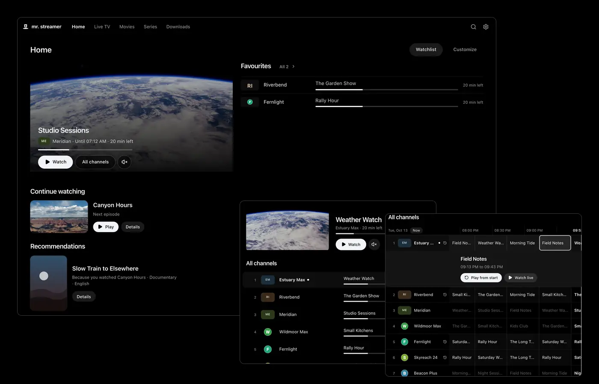

  <picture>
    <source media="(prefers-color-scheme: dark)" srcset="docs/assets/readme-mark-dark.svg">
    
  </picture>

<h1 align="center">Mr. Streamer</h1>

Live TV, movies and series. An open source IPTV player for Mac, Windows and Linux.

<strong><a href="https://mrstreamer.app/download">Download</a></strong> · <a href="https://apps.microsoft.com/detail/9N45GG76ZP4T?referrer=appbadge">Microsoft Store</a> · <a href="https://discord.gg/sR4tjEw6bQ">Discord</a>

- Live TV with favourites, [your own channel lists, programme reminders](docs/user/live-tv.md#your-lists) and a [guide grid](docs/user/live-tv.md#the-guide). Aired programmes play from their start when your provider keeps catch-up.
- Movies and series with resume, a [watchlist](docs/user/movies-and-series.md#watchlist) and [offline downloads](docs/user/downloads.md) you can pause and reorder, whole series included.
- Every sound and subtitle track your provider sends, and [online subtitle search](docs/user/playback.md#online-subtitles) with your own API key.

## Is it for you?

Bring your own Xtream Codes login or M3U playlist; Mr. Streamer includes no channels and sells none. If it doesn't do what you need, the last column names players whose own sites say they do.

| You want                                      | Mr. Streamer                                                      | Also documented by                                                                          |
| --------------------------------------------- | ----------------------------------------------------------------- | ------------------------------------------------------------------------------------------- |
| **Watch on a Mac, Windows or Linux computer** | Yes                                                               | VLC, Kodi; IPTV Smarters on macOS and Windows; IPTVX on Apple silicon Macs                  |
| **Watch on Android TV**                       | No, computers only                                                | TiviMate, IPTV Smarters, IPTVX                                                              |
| **Sign in with Xtream Codes**                 | Yes, or add an M3U link                                           | TiviMate, IPTVX; IPTV Smarters names a provider API login                                   |
| **Add your own XMLTV guide**                  | Yes, it fills in channels your provider's guide misses            | IPTVX with your EPG URL; Kodi with IPTV Simple                                              |
| **Download movies and series**                | Yes, whole series included                                        | IPTVX on iPhone and iPad                                                                    |
| **Record live TV**                            | No; catch-up plays aired programmes when your provider keeps them | TiviMate; IPTVX with IPTVX Media Server; VLC's record button                                |
| **Play on a TV**                              | AirPlay on macOS, Google Cast on Windows; not on Linux            | IPTVX with AirPlay 2; VLC with Chromecast                                                   |
| **Free and open source**                      | Yes, GPL-3.0, no ads or account                                   | VLC, Kodi. TiviMate and IPTVX have paid tiers; IPTV Smarters sells premium in its Apple app |

Every player, side by side

Kodi is compared with its official [IPTV Simple](https://github.com/kodi-pvr/pvr.iptvsimple) add-on. VLC is a general media player. Not documented means the sources below don't say; it doesn't mean no.

|                   | Platforms                                                                                         | Xtream / M3U                                 | Guide (XMLTV)                                                             | Movies and series                                   |
| ----------------- | ------------------------------------------------------------------------------------------------- | -------------------------------------------- | ------------------------------------------------------------------------- | --------------------------------------------------- |
| **Mr. Streamer**  | macOS 13 or later (Apple silicon), Windows 11, x86_64 Linux                                       | Xtream login, M3U link                       | Provider or playlist guide, then your own XMLTV guides; grid and catch-up | Library with TMDB details; M3U after mapping groups |
| **TiviMate**      | Android TV; touch devices not optimised                                                           | Xtream Codes, M3U, Stalker Portal            | Guide grid; XMLTV address not documented                                  | Not documented                                      |
| **IPTV Smarters** | Windows, macOS, Android, Android TV, iPhone, iPad, Apple TV, LG and Samsung TVs                   | M3U, provider API login (Xtream not named)   | Guide from your source; XMLTV address not documented                      | Movies and series                                   |
| **IPTVX**         | Apple silicon Mac, iPhone, iPad, Apple TV, Apple Vision, Android, Android TV; Fire OS by sideload | Xtream, M3U                                  | Server guide, or your own EPG URL                                         | Movies and series                                   |
| **VLC**           | Windows, macOS, Linux, Android, iOS                                                               | Opens playlists; Xtream login not documented | Not documented                                                            | Plays playlist entries                              |
| **Kodi**          | Windows, macOS, Linux, Android, iOS, tvOS, webOS, Raspberry Pi                                    | M3U file or URL; Xtream login not documented | XMLTV file or URL, compressed too                                         | VOD entries from M3U, listed under Recordings       |

|                   | Downloads                                         | Live TV recording                                  | Casting                                             | Price, source                                                              |
| ----------------- | ------------------------------------------------- | -------------------------------------------------- | --------------------------------------------------- | -------------------------------------------------------------------------- |
| **Mr. Streamer**  | Movies, episodes, whole series; pause and reorder | No; catch-up when your provider keeps it           | AirPlay on macOS, Google Cast on Windows; not Linux | Free, open source (GPL-3.0)                                                |
| **TiviMate**      | Not documented                                    | Yes                                                | Not documented                                      | Free, premium in-app purchase                                              |
| **IPTV Smarters** | Not documented                                    | Not documented                                     | Not documented                                      | Apple app: free with ads, premium purchase; other platforms not documented |
| **IPTVX**         | On iPhone and iPad                                | Scheduled, with IPTVX Media Server on a NAS or Mac | AirPlay 2, casting                                  | Free download; a subscription unlocks its features                         |
| **VLC**           | Convert/Save writes a file                        | Record button saves what plays                     | Chromecast                                          | Free, open source                                                          |
| **Kodi**          | Not documented                                    | Not documented for IPTV Simple                     | Not documented                                      | Free, open source                                                          |

Checked 27 October 2026 against each player's own site, docs or store listing; a player not named may still do it. TiviMate: [Google Play](https://play.google.com/store/apps/details?id=ar.tvplayer.tv). IPTV Smarters: [features](https://getiptvsmarters.com/features), [downloads](https://getiptvsmarters.com/download), [App Store](https://apps.apple.com/us/app/smarters-player-lite/id1628995509). IPTVX: [iptvx.app](https://iptvx.app/), [features](https://iptvx.app/features/index.html), [Media Server](https://iptvx.app/server/), [App Store](https://apps.apple.com/us/app/iptvx/id1451470024), [Google Play](https://play.google.com/store/apps/details?id=com.bendingx.iptvx.android). VLC: [videolan.org](https://www.videolan.org/vlc/), [recording](https://docs.videolan.me/vlc-user/desktop/3.0/en/basic/recording/playing.html), [Convert/Save](https://docs.videolan.me/vlc-user/desktop/3.0/en/gettingstarted/desktopoverview/windows_and_linux/menu_bar.html), [Chromecast](https://www.videolan.org/vlc/releases/3.0.0.html). Kodi: [downloads](https://kodi.tv/download/), [IPTV Simple](https://github.com/kodi-pvr/pvr.iptvsimple), [its source](https://github.com/kodi-pvr/pvr.iptvsimple/blob/Piers/src/IptvSimple.cpp).

## Download and set up

Stable 0.0.20 runs on macOS 13 or later on Apple silicon, Windows 11 on x64 and x86_64 Linux. [Installers and checksums](https://mrstreamer.app/download) · [GitHub Releases](https://github.com/Mr-Streamer-OSS/MrStreamer/releases/latest) · [Homebrew, AUR and updates](docs/user/updates.md)

Open the app and add your Xtream Codes login or M3U link on the Connect screen. [Subscriptions guide](docs/user/subscriptions.md)

## Help

[Live TV](docs/user/live-tv.md) · [Movies and series](docs/user/movies-and-series.md) · [Downloads](docs/user/downloads.md) · [What plays](docs/user/playback.md) · [Troubleshooting](docs/user/troubleshooting.md) · [Privacy](docs/privacy.md) · [Security](docs/security.md)

Ask on [Discord](https://discord.gg/sR4tjEw6bQ), which also announces Stable and Nightly releases. Found a bug? [Report it](https://github.com/Mr-Streamer-OSS/MrStreamer/issues/new/choose) with your system, the version from Settings > About, and what happened.

## Contributing and licence

Small bug fixes are welcome: [CONTRIBUTING.md](CONTRIBUTING.md) explains how to report a bug, run the app and send a fix. GPL-3.0, see [LICENSE](LICENSE). Installers include FFmpeg and x264 under the GPL, with their exact sources attached to every release. Settings > About > Open-source licences lists every component the app ships, with its licence.

Movie and series details come from [TMDB](https://www.themoviedb.org). This application uses TMDB and the TMDB APIs but is not endorsed, certified, or otherwise approved by TMDB. Where titles stream comes from [JustWatch](https://www.justwatch.com).

Pictures show a test provider with made-up titles and public-domain footage. Store screenshots and the trailer include Big Buck Bunny (c) copyright 2008, Blender Foundation, [www.bigbuckbunny.org](https://www.bigbuckbunny.org), [CC BY 3.0](https://creativecommons.org/licenses/by/3.0/): excerpts, renamed and subtitled in the demo. Earth views: NASA. Grand Canyon footage: U.S. National Park Service.
