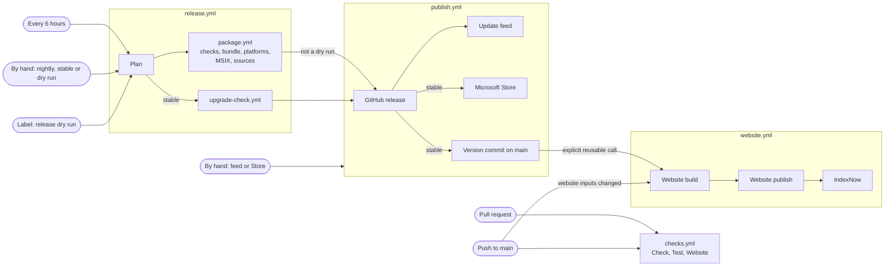

# CI: what runs when

> For maintainers. [Releasing](releasing.md) has the release policy, [testing](../contributing/testing.md#ci) what the checks check.

Six workflow files in `.github/workflows`: five named workflows and `package.yml`, which only `release.yml` calls. Two shared actions live in `.github/actions`:

- `checks.yml`: the app's and the website's checks.
- `release.yml`: plans a run, then builds each release through `package.yml` and publishes it through `publish.yml`.
- `package.yml`: builds and checks one release's files on every platform. Only `release.yml` calls it.
- `publish.yml`: the GitHub release, the update feed and the Microsoft Store.
- `website.yml`: independent main delivery, manual retry and stable refresh.
- `upgrade-check.yml`: the Windows installed upgrade check.
- `.github/actions/setup`: what every package job starts with. `.github/actions/package-receipt`: what every package job ends with.

A stable run that finds `main` ahead of the latest nightly runs `package.yml` and `publish.yml` twice: a nightly of `main` first, then the stable release. The stable release builds only once that nightly is published and the feed names it.

## Triggers, inputs, secrets and environments

| Workflow            | Starts on                                                                     | Inputs                                                                                                                                                                                                                 | Secrets and variables                                                                                                                                                                                                                                                                                                                          | Environments                                              |
| ------------------- | ----------------------------------------------------------------------------- | ---------------------------------------------------------------------------------------------------------------------------------------------------------------------------------------------------------------------- | ---------------------------------------------------------------------------------------------------------------------------------------------------------------------------------------------------------------------------------------------------------------------------------------------------------------------------------------------- | --------------------------------------------------------- |
| `checks.yml`        | every pull request, every push to `main`, a call from `package.yml`           | called: `sha`, `report-name`                                                                                                                                                                                           | none                                                                                                                                                                                                                                                                                                                                           | none                                                      |
| `release.yml`       | schedule `17 */6 * * *`; by hand; a pull request labelled **release dry run** | by hand: `channel` (nightly or stable), `version`, `nightly`, `dry-run`                                                                                                                                                | passes all of them on to `package.yml` and `publish.yml`                                                                                                                                                                                                                                                                                       | none of its own                                           |
| `package.yml`       | a call from `release.yml`                                                     | `channel`, `version`, `sha`, `dry-run`; gives back `sources` and `msix-sha256`                                                                                                                                         | `TMDB_API_KEY`; `POSTHOG_PROJECT_TOKEN` and the variable `POSTHOG_HOST`, outside dry runs; `MAC_CERTIFICATE_P12`, `MAC_CERTIFICATE_PASSWORD`, `APPLE_API_KEY_P8`, `APPLE_API_KEY_ID`, `APPLE_API_ISSUER` and the variable `APPLE_TEAM_ID`                                                                                                      | none                                                      |
| `publish.yml`       | a call from `release.yml`, never for a dry run; by hand from `main`           | called: `channel`, `version`, `tag`, `sha`, `previous-tag`, `sources`, `msix-sha256`, `feed-required`. By hand: `target` (feed or store), `allow-regress`, `store-action`, `version`, `draft`, `draft-metadata-sha256` | Store: `STORE_AUTOMATION_ENABLED`, and in its environment `STORE_CLIENT_SECRET`, `STORE_TENANT_ID`, `STORE_CLIENT_ID`, `STORE_CLIENT_SECRET_EXPIRES`. Website (in `website.yml`): `MARKETING_DEPLOY_ENABLED`, `POSTHOG_HOST`, `POSTHOG_PROJECT_TOKEN` (variables), and in its environment `VERCEL_TOKEN`, `VERCEL_ORG_ID`, `VERCEL_PROJECT_ID` | `github-pages`, `microsoft-store`, `marketing-production` |
| `upgrade-check.yml` | a call from `release.yml` for a stable release; by hand from `main`           | `candidate`: a published nightly's tag; called: also `sha`, the commit it must name                                                                                                                                    | none                                                                                                                                                                                                                                                                                                                                           | none                                                      |

Only the jobs that need a secret read it: the bundle job the TMDB and analytics keys, the macOS packaging step the signing secrets, the last step of the Store job the Store key, and the website publish job the Vercel token. `publish.yml` and `website.yml` name their respective publication environments.

## Which commit runs what

A release's jobs check out the commit the plan resolved, so `main` moving during a run changes nothing. For a stable release that is the tested nightly's commit, which can be older than the workflows.

- The product comes from the release's commit: its build, its tests, its own scripts and its package receipts.
- The tools that set up and judge a build come from the workflow commit, checked out beside it in `.workflow`: the setup and receipt actions, the Windows ffmpeg toolchain and the Store package check.
- `publish.yml` runs the workflow commit's scripts on the files the run built. The feed job reads `main`, and the version commit goes to the branch the run started from, `main`.

## Each path

- **Pull request:** `checks.yml` runs Check (knip, lint, format, typecheck, `pnpm actionlint`, build), Test and Website. A new push cancels the running checks. Nothing else starts: `publish.yml` has no pull request trigger.
- **Push to `main`:** `checks.yml` runs Check and Test. When the push changes what the website is built from, `website.yml` builds the website and, with `MARKETING_DEPLOY_ENABLED`, publishes it. Pushes by the workflow token, such as the version commit, start nothing.
- **Nightly:** every six hours the plan (`scripts/release-plan.ts plan`) builds a nightly when the last one is at least five hours old and `main` has commits it lacks, and skips otherwise. `package.yml` runs Checks and Test on the commit, builds the bundle, the three platforms and the sources; then `publish.yml` publishes a pre-release and updates the feed. A failed feed update shows on its job without failing the run. Nightlies build no Store package and leave the website alone. A nightly by hand skips both conditions. Five hours rather than six leaves room for the hour a nightly takes to publish, so nightlies come about every six hours while `main` changes.
- **Dry run:** the **release dry run** label on a pull request from this repository builds its head; a run by hand with **dry-run** ticked builds the selected branch. The plan makes every pull request event a dry run. `package.yml` runs with `dry-run`, which adds the release UI proof and the Store package, compiles analytics out, and keeps the files 14 days. `publish.yml` is never called. Dry runs of one pull request or branch queue together, apart from releases.
- **Stable release:** by hand from `main`, naming the tested nightly. If `main` is ahead of the latest nightly, a nightly of `main` is built and published first, and the stable release waits until the feed names it. Then `package.yml` rebuilds the tested nightly's commit with the stable version, including the Store package, while `upgrade-check.yml` installs the newest stable release on Windows and upgrades it to the tested nightly. `publish.yml` runs once both passed.
- **GitHub release:** `publish.yml`'s first job checks every platform's files and every source are there (`release-plan.ts check`, against `packages/contracts/src/release-files.ts`) and the version is still new, writes the checksums and notes, removes an unfinished draft of the same tag, and publishes. It refuses a pull request event.
- **Discord:** after each successful GitHub publication, an optional job posts Stable or Nightly to its channel, including a stable run's first nightly. `DISCORD_STABLE_WEBHOOK_URL` and `DISCORD_NIGHTLY_WEBHOOK_URL` are repository Actions secrets. Missing configuration and delivery errors warn without failing the publisher. [Setup, permissions and verification](discord.md).
- **Update feed:** after every published release, and by hand with target **feed**. It merges the releases with the deployed feed, never moving a channel down unless **allow-regress** says so, and deploys to Pages through `github-pages`, one publication at a time.
- **Microsoft Store:** after a published stable release, and by hand with target **store**. The gate job reads `STORE_AUTOMATION_ENABLED` and the `microsoft-store` environment's branch rule before any job names it; while submissions are off a release's run stops there with a notice. The Store job checks the release and the run's own package against its checksum, then submits. When the MSIX failed outside a dry run, the release still goes out and this job fails for want of a checksum.
- **Version commit:** after a published stable release, `chore(release): prepare vX` on `main`, retried while `main` moves.
- **Website:** after the version commit of a stable release, after a push that changes its inputs, and by hand through **Website** on `main`. Stable finalization calls Website explicitly, without waiting for feed or Store outcomes. A workflow-token push is not the handoff. The build job has no owner secrets and builds `main` as it is. The publish job, in `marketing-production` with `MARKETING_DEPLOY_ENABLED`, checks out nothing, compares `main` with the build over the push trigger's paths and leaves publishing to a newer run when `main` changed the website, then deploys the prebuilt package to Vercel. One publication at a time.
- **IndexNow:** after a publication that actually deployed, the notifier from the same build checks the public site carries that build's marker, then notifies once.
- **Upgrade check:** inside a stable release, and by hand from `main` with a nightly's tag. Inside a release the tag must name the commit the plan resolved, so the check proves the source the release builds. It derives the prior stable release from the releases, checks both setups against their published checksums, and installs, upgrades and restarts on a disposable Windows runner. It holds no secret and publishes nothing.

## Queues and retention

- Releases share one queue (`release-main`); each pull request's or branch's dry runs have their own. None is cancelled.
- Within `publish.yml`, the feed (`update-feed`), the Store (`microsoft-store`) each publish one at a time without cancelling a waiting run. Website uses its own `marketing-production` queue without cancellation. The upgrade check runs one at a time (`upgrade-check`).
- Release files are kept 3 days (dry runs 14), the Store package 90 days (dry runs 14), a failed Store package 14, release UI proof 14, test reports 7, upgrade evidence 14 and a failed upgrade's profile 7.

## Checking a change to CI

`pnpm actionlint` lints the workflow files, with shellcheck on each workflow `run:` script, and runs in Check on every pull request. It checks how workflows use the shared actions, but not the shell inside the actions themselves. `test/publication-guard.test.ts` evaluates the real `if:` conditions and `with:` inputs of `release.yml`'s publishing calls and of every `publish.yml` job, for every event, dry-run output, channel, result of the jobs they wait for, ancestor failure and run cancellation, and fails if anything a pull request or dry run starts would publish. A context it doesn't model fails the test instead of reading as a guessed value, and the conditions that got past earlier versions of the guard stay in it as probes. `test/release.test.ts`, `test/store-release.test.ts` and `apps/desktop/test/package-receipt.test.ts` cover the scripts the workflows run. A change to `package.yml` or the shared actions needs a dry run of its pull request. Changes to publication routing require independent review and a signed non-publishing PR dry run. Actual production deployment and stable handoff integration proof remain pending a separately approved delivery.

## Independent Website delivery

Website builds on relevant main pushes, a manual run, or the explicit call after stable finalization. Its push inputs include website sources, public docs, shared release contracts, desktop version and dependency manifests. Changes to Website/Publish workflows and maintainer/testing docs also validate the build, but those paths alone cannot deploy. The build compares the triggering push before/after commits over the deployment inputs; an unreadable comparison fails closed. Checks owns secretless PR website validation, so Website has no PR trigger.

Manual Website runs default to deploying; untick **deploy** for build-only validation. Publication requires `main`, a successful build, an authorized input change or explicit request, `MARKETING_DEPLOY_ENABLED`, and `marketing-production`. The publisher retains stale-build refusal, serialization and prebuilt-byte deployment. IndexNow runs only after a deployment. Retrying Website never builds desktop packages or repeats GitHub/Store publication.
